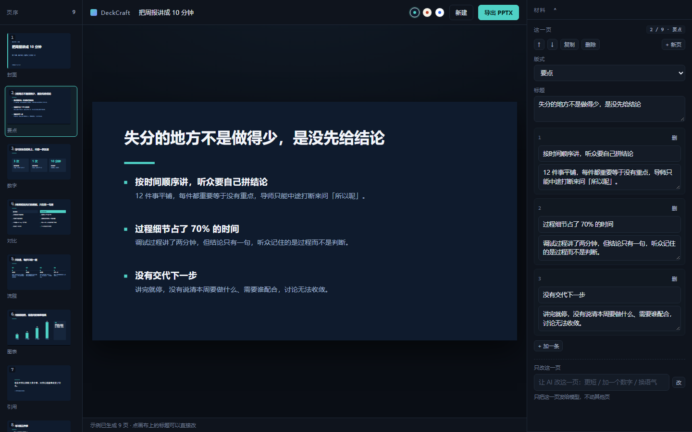

# DeckCraft

把一段材料变成一份**能讲的**演示文稿，导出真 `.pptx`。

Anna App · 在 [Anna staging](https://staging.anna.partners) 里搜 DeckCraft，或在对话里 `#deckcraft` 直接叫出来。



---

## 它解决什么问题

用 AI 做 PPT 的工具已经很多，但大多卡在同一个地方：**生成完就结束了**。

- 给的是一堆排好版的文字，不是一条能讲下来的线索；
- 想改一个字只能整份重生成，前面的调整白费；
- 导出的是图片，或者一堆散落的文本框，在 PowerPoint 里动一下就乱。

DeckCraft 的判断是：**做 PPT 的难点在「讲什么」，不在「怎么排」**。所以它先给结论再给版式；排版可以反复换而不花钱；导出的每一页都是 PowerPoint 原生对象，拿到文件还能继续改。

## 它做什么

| 能力 | 说明 |
|---|---|
| 材料 → 骨架 | 贴周报、会议纪要、论文摘要，或只写一句主题。生成整份的叙事顺序，每页标题是一句**可以被反驳的判断**，不是「背景」「现状」这类标签 |
| 改骨架 | 生成后先看到整份的标题序列，直接在画布上改文字，再决定版式 |
| 换版式 / 换主题 | 7 种版式、3 套主题，纯前端重算，**不调用模型、不消耗额度** |
| 改单页 | 「更短」「加一个数字」「换语气」——只把这一页发给模型，不动其他页 |
| 导出 .pptx | 16:9，文本框 / 形状 / 图表都是原生对象；图表是 PowerPoint 原生图表，双击能改数据 |
| 聊天触发 | 在 Anna 对话里 `#deckcraft 把这份周报做成 10 页`，窗口自动打开并开始生成 |

## 架构

```
Anna 对话 ──#mention──▶ 模型调 open_app_view(payload={brief})
                              │
                              ▼
                    ┌──────────────────────┐
                    │  iframe（本 bundle） │
                    │  js/layout.js        │  一份坐标规格
                    │     ├─▶ js/render.js  → DOM 预览
                    │     └─▶ js/export.js  → PptxGenJS
                    └──────────────────────┘
                              │ anna.llm.complete
                              ▼
                        平台代付模型
```

**纯 UI App**：manifest `schema: 4`，不打包任何 Executa。所有能力走 Host API（`llm` / `storage` / `upload` / `chat`），没有自己的服务端、没有 API key、没有数据库。

代价是不能在聊天里直接甩一个文件（必须开窗）；换来的是安装时零权限声明、没有进程冷启动、编辑与预览都在浏览器里即时完成。

### 一份坐标，两个渲染器

`layout.js` 把每页编译成与渲染器无关的图元（矩形 / 文本 / 线 / 图表，单位英寸），DOM 预览和 PPTX 导出消费同一份数据。所见即所得不是靠人工对齐，而是**结构上只存在一份**。

### 导出为什么"还能改"

`export.js` 里没有一处把内容画成图片：

| 预览里的东西 | 导出的东西 |
|---|---|
| 标题、正文 | `addText` 文本框（16:9，`fit: shrink`） |
| 色块、分隔线 | `addShape` 矩形 / 直线 |
| 柱状图、折线、饼图 | `addChart` 原生图表，数据可编辑 |

## 本地跑

不需要注册账号，也不需要额度：

```bash
npm i -g @anna-ai/cli                          # 需要 Node 22+
uvx anna-app-runtime-local@0.2.0a33 --help     # 预热运行时（原因见 PLATFORM-NOTES #2）
cd deckcraft
anna-app dev --no-llm                          # http://localhost:5180
```

要直接看一份完整示例（跳过模型、用内置数据）：

```
http://localhost:5180/anna-apps/deckcraft/dev/index.html#demo
```

```bash
anna-app validate --strict               # manifest + bundle 静态检查
npm run smoke                            # 不开浏览器，跑 layout → pptx 并检查结构
python tools/check-pptx.py out/*.pptx    # 逐页校验图元有没有跑出画布
node tools/shot.mjs <url> <name> [页码]   # headless 截图，同时抓 console 报错
```

## 目录

```
manifest.json          App 清单：视图、提示词追加、能力声明
app.json               商店文案
bundle/
  index.html           三栏外壳
  css/app.css          编辑器 UI（与幻灯片主题无关）
  js/layout.js         ★ 版式引擎：一份坐标，两个渲染器
  js/render.js         DOM 渲染（预览、缩略图、自动缩字）
  js/export.js         PPTX 导出（PptxGenJS 由外部注入，浏览器/Node 同源）
  js/deck.js           数据模型与规范化（把 AI 输出收敛成可信结构）
  js/prompt.js         提示词（整份生成 / 单页改写）
  js/llm.js            宿主模型调用 + JSON 容错解析
  js/app.js            控制器
  js/theme.js          主题令牌
  js/mock.js           离线示例数据
  vendor/              PptxGenJS 4.0.1（MIT）
tools/                 冒烟、几何检查、截图、图标生成
docs/                  DESIGN.md（产品取舍）· PLATFORM-NOTES.md（平台踩坑）
```

## 已知限制

- **字体**：导出用 `Microsoft YaHei`，Windows 版 Office 与 macOS 自带；Linux 上会被替换，建议导出后在本机确认一次。
- **图表预览**：预览用 SVG 近似，导出是 PowerPoint 原生图表，数值与分类一致，细节不完全等价。
- **单页改写依赖模型**：额度耗尽时该按钮不可用，其余编辑不受影响。
- **没有 AI 配图**：一张图几十 CU，而这类内容用色块和图表讲更清楚。这是取舍，不是没做完。

## 许可

MIT。PptxGenJS 4.0.1 同样是 MIT，见 `bundle/vendor/pptxgenjs-LICENSE`。
